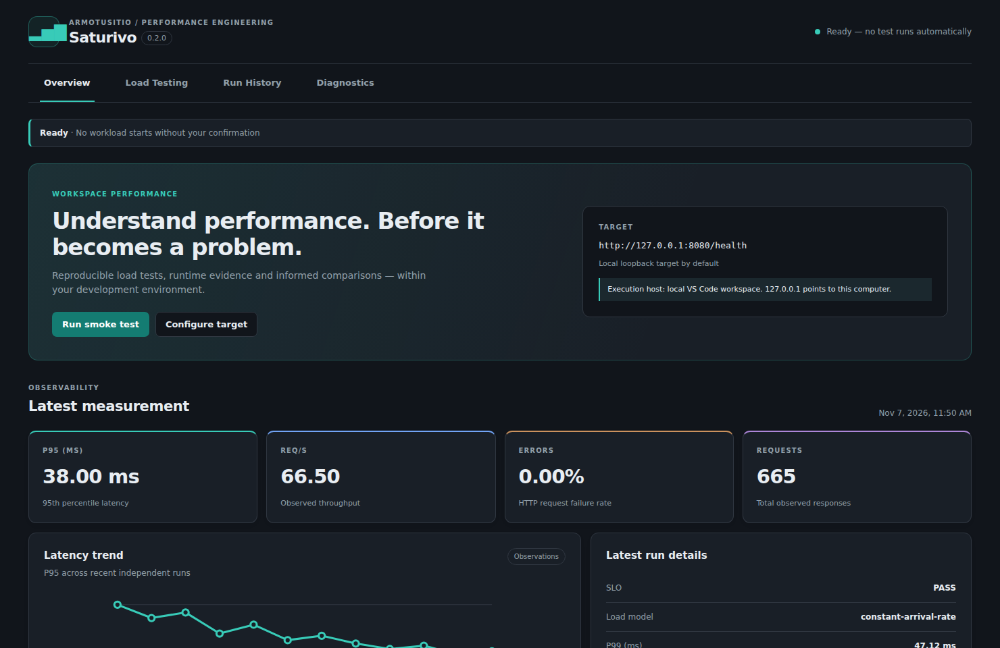
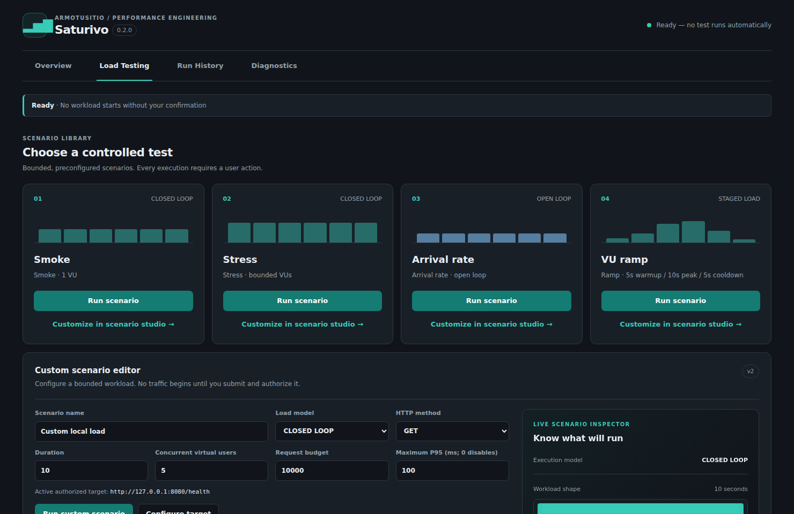
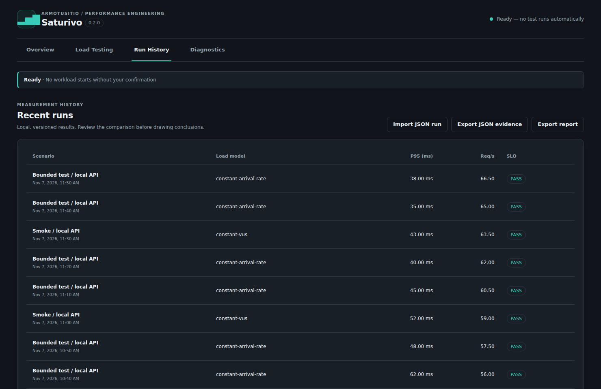
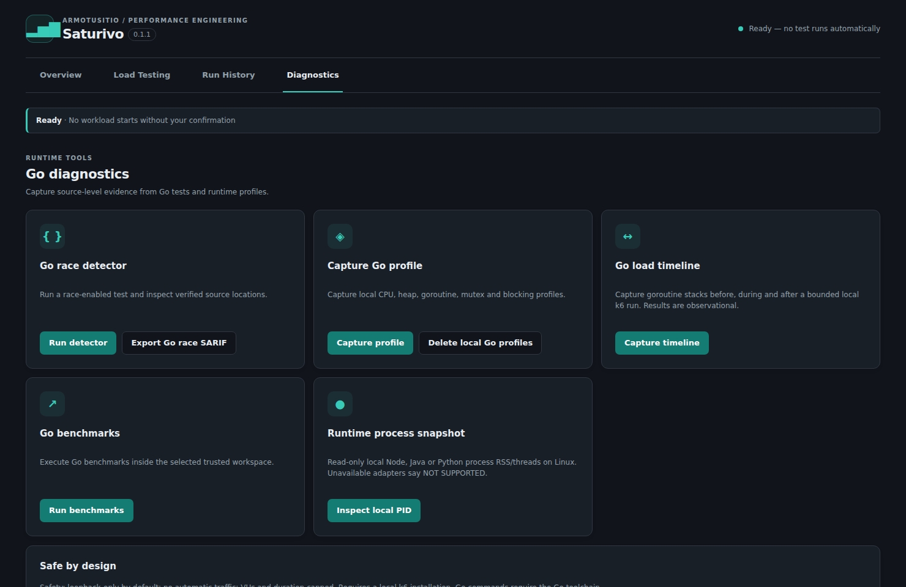

  

<h1 align="center">Saturivo</h1>

<strong>Find the limits. Fix the bottlenecks.</strong>

  Local-first load testing and evidence-driven concurrency diagnostics inside Visual Studio Code.

  <strong>by <a href="https://armotusitio.com.ar">ArmoTuSitio</a></strong>

  <a href="#why-saturivo">Overview</a> ·
  <a href="#capabilities">Capabilities</a> ·
  <a href="#quick-start">Quick start</a> ·
  <a href="#go-diagnostics">Go diagnostics</a> ·
  <a href="#security--privacy">Security</a> ·
  <a href="docs/README_ES.md">Español</a>

---

> **Public source · 0.2.0 non-preview release candidate (PR #5; unreleased).** The extension is now packaged without the VS Code Marketplace Preview badge, but **this is not a release approval or Enterprise AAAA certification**. See [implementation status](STATUS.md) and [measurable Enterprise AAAA plan](docs/ENTERPRISE_AAAA_MASTER_PLAN.md). Local measurements do not certify production capacity.

## Control Center — 0.2.0

The new Control Center opens in a **full editor tab**, not a narrow sidebar. The screenshots below are captured from the **real dashboard renderer** with a fixed **synthetic test dataset**; the displayed metrics are illustrative, not real performance measurements.

View load scenarios, run history and Go diagnostics

### A workflow designed for developers

The 0.2.0 Control Center is more than a set of commands: it guides setup, bounded execution, comparison and investigation. The **Scenario Studio** provides a live workload preview, readable safety budgets, interactive ramp editing, and preset cards that can be customized **without starting traffic**. Results include an accessible exact-value table and clear evidence limitations.

The dashboard uses VS Code theme tokens, responsive layouts, keyboard navigation, and reduced-motion support. Preview and selection are local interactions; only an explicit run action can begin a workload.

## Why Saturivo?

Load generators can tell you *that* latency increased. Saturivo helps keep the evidence needed to investigate *what changed*: the workload, latency distribution, failure rate, server-side Go behavior, and baseline.

Instead of replacing mature load engines, Saturivo orchestrates **Grafana k6**, selected **Go tooling**, and locally stored measurements in one developer workflow.

| Question | What Saturivo provides |
|---|---|
| Is my API behaving well under controlled traffic? | Manual, bounded HTTP load scenarios with P50/P95/P99, requests/sec, error rate and dropped iterations |
| Did my change degrade performance? | Scenario fingerprints, local history, descriptive comparisons and optional repeated-trial P95 uncertainty |
| Are goroutines or locks involved? | Opt-in Go pprof capture, observed goroutine states and `go tool pprof` output |
| Does my code exhibit an observed data race? | `go test -race`, source-linked VS Code diagnostics and SARIF export |
| Can I reproduce and share the measurement? | Stored JSON evidence, Markdown reports and explicit workload/environment metadata |

## Capabilities

| Area | Implemented in the PR #5 development branch | Important boundary |
|---|---|---|
| **Load testing** | k6 presets, ramping VUs, and a bilingual editor for bounded v2 HTTP GET/HEAD workloads | HTTP(S) GET/HEAD only; local target by default |
| **Metrics & SLOs** | RPS, failures, P50/P95/P99, dropped iterations; configurable P95 SLO | Single-run status is not a statistical confidence guarantee |
| **Comparisons & capacity pilot** | Workload SHA-256, explicit baseline choice, 3-vs-3 P95 bootstrap, bounded literal-loopback arrival-rate pilot | Evidence is local and scenario-specific; **not a production capacity guarantee** |
| **WebSocket probe** | Explicit local ws:// loopback handshake/message probe backed by k6, with a fixture-backed E2E gate | Session duration is not HTTP latency; 5 seconds, 1 VU, 100 attempts; remote WebSocket targets are blocked |
| **Go concurrency** | Race detection, benchmarks, CPU/heap/goroutine/mutex/block profiles, Go runtime trace and before/during/after stack observations | Tests only inspect executed paths; no automated root-cause proof |
| **Evidence** | Markdown/JSON export; SARIF for observed Go race findings | Profiling files and reports may contain sensitive project information |
| **Developer experience** | Full editor-tab Control Center launched from Activity Bar, ES/EN interface, scenario form persistence, explicit cancellation and history deletion | No background stress testing; trusted workspaces only |

**Experimental bounded capacity pilot:** up to three explicitly authorized loopback arrival-rate steps with a P95 SLO; passing rates do not certify production capacity. Saturivo 0.2.0 includes isolated warm-up/measurement/cool-down for v2, 3×3 regressions with uncertainty, Go race source evidence, pprof/trace/GC observations, real fixture-backed HTTP Go/Node/Python and bounded RFC6455 WebSocket. **Not implemented or not verified:** general gRPC/ghz, language-specific profilers Node/Java/Python, WSL/SSH/Dev Containers E2E and BYO AI. See [roadmap](ROADMAP.md).

## Quick start

### Prerequisites

- **Visual Studio Code 1.99+** (development and integration baseline).
- **Grafana k6** installed and available on your `PATH`. See the [official installation guide](https://grafana.com/docs/k6/latest/set-up/install-k6/).
- **Go** (optional) for race detection, benchmarks and `pprof` analysis.
- **Node.js 22+** and npm for building this extension from source.
- Git access to the public Saturivo source repository.

### Build and install the 0.2.0 candidate from source

~~~bash
git clone https://github.com/Drako01/saturivo.git
cd saturivo
git switch feat/enterprise-aaaa-v0.1.1
npm ci --ignore-scripts
npm run verify
npm run package:vsix
~~~

Open VS Code → **Extensions: Install from VSIX…** → select `saturivo.vsix`. To debug the extension instead, open the repository in VS Code and press **F5** to launch an Extension Development Host.

### First measurement in five steps

1. Start a **disposable, authorized local API** (for example, `http://127.0.0.1:8080/health`).
2. Click the **Saturivo** Activity Bar icon. The Control Center opens; **opening the view never starts traffic**.
3. Choose **Configure Target**. Set the explicit local endpoint.
4. Run **Smoke** (1 virtual user), **Bounded Stress** (up to 20 VUs) or **Arrival Rate** (25 attempted iterations/sec, bounded by available VUs). Each operation is user-initiated and can be cancelled.
5. Inspect **P95/P99, RPS, failures, dropped iterations and run history**. Repeat comparable scenarios, choose **Compare Runs** and select an explicit baseline before exporting evidence.

**Custom scenarios:** the Load Testing section includes a v2 editor for bounded GET/HEAD traffic (constant VUs, arrivals and ramp stages), with the current authorized target, per-run request limit and an optional P95 objective. Optional warm-up/cool-down windows exclude setup and recovery requests from the measured P50/P95/P99, HTTP error rate, RPS and SLO, while request budgets still apply across the whole run. Input is validated again inside the extension. **WebSocket:** the separate local-only probe explicitly asks for a ws:// loopback endpoint and confirmation; its report shows session and handshake metrics, not HTTP request latency.

**Experimental local capacity pilot:** first configure a **P95 SLO**, keep the target on a literal loopback HTTP address (for example `http://127.0.0.1:8080/health`), then explicitly choose **Local Capacity Pilot**. It attempts 10, 20 and 40 arrivals/s at most, with three 10-second stages, resource budgets and stop-on-SLO/inconclusive behavior. Review the evidence in the output channel and run history. This is **not a production capacity benchmark**.

For more reproducible before/after analysis, keep hardware, runtime, target configuration and scenario identical across runs. A scenario SHA-256 identifies the workload; it is **not** a substitute for matching every environmental factor.

## Configuration

Use **Settings → Extensions → Saturivo** or `settings.json`:

~~~json
{
  "saturivo.target": "http://127.0.0.1:8080/health",
  "saturivo.k6Path": "k6",
  "saturivo.durationSeconds": 10,
  "saturivo.maxVirtualUsers": 100,
  "saturivo.maxRequests": 10000,
  "saturivo.sloMaxP95Ms": 250,
  "saturivo.allowRemoteTargets": false,
  "saturivo.goProfilerOrigin": "http://127.0.0.1:6060/"
}
~~~

| Setting | Default | Behavior |
|---|---|---|
| `saturivo.target` | `http://127.0.0.1:8080/` | HTTP(S) target. Prefer a disposable local endpoint |
| `saturivo.k6Path` | `k6` | Executable resolved from `PATH` or an explicit path |
| `saturivo.durationSeconds` | `10` | 5–120 seconds |
| `saturivo.maxVirtualUsers` | `100` | Hard ceiling, 1–100; built-in stress presets use up to 20 |
| `saturivo.maxRequests` | `10000` | Hard request budget, 100–100000; capacity interpretation becomes inconclusive if hit |
| `saturivo.sloMaxP95Ms` | `0` | Optional P95 objective; 0 disables the objective |
| `saturivo.allowRemoteTargets` | `false` | Remote traffic is disabled unless explicitly enabled and confirmed for each run |
| `saturivo.goProfilerOrigin` | `http://127.0.0.1:6060/` | Local literal-loopback `net/http/pprof` endpoint; profiling always opt-in |

### Interpreting the results

- **P95 / P99** describe measured request latencies, not an unconditional production SLO guarantee.
- **RPS** is achieved HTTP throughput for the measured workload.
- **Dropped iterations** indicate a failure to sustain the requested arrival rate; do not confuse them with server-side errors.
- **PASS / FAIL / INCONCLUSIVE** evaluate configured objectives and evidence quality. A request budget hit or insufficient sample count can make a result inconclusive.
- **Repeated trials**: after at least three compatible runs per group, Saturivo can estimate uncertainty for the change in median run-level P95 using a deterministic bootstrap. This is useful evidence, not a causality proof.

See [Performance measurement methodology](docs/METHODOLOGY.md).

## Go diagnostics

Saturivo uses the **local Go toolchain** and runtime evidence, not AI guesses.

**Data races.** Choose **Go Race Detector** to run `go test -race ./...` after explicit confirmation. Observed race locations appear in **Problems** and can be exported as SARIF. No findings means *no race was observed in exercised paths*, not that the program is race-free.

**Benchmarks.** Choose **Go Benchmarks** to execute `go test -run ^$ -bench . -benchmem ./...`. Running project tests can execute arbitrary project code; Saturivo always asks first.

**Runtime profiling.** Expose `net/http/pprof` **only on a local loopback listener** for an explicitly authorized development service. In Saturivo, set the origin, select **Capture Go Profile**, choose CPU, heap, goroutine, mutex or block, and confirm. Captured artifacts are saved locally. Binary profiles can be summarized with `go tool pprof`; goroutine stack snapshots show observed states but **do not certify leaks**.

> **Privacy note:** pprof dumps, stack traces, diagnostic paths and exported run metadata may reveal internal code or system information. Do not publish them without review and redaction.

## Security & privacy

Saturivo is built **local-first and permission-first**:

- No implicit load generation or background profiling.
- Local/loopback HTTP targets by default; remote load requires an explicit setting **and** per-run confirmation.
- HTTP load supports read-only methods, redirects are disabled and test duration, VUs and request counts are bounded.
- Bounded subprocess output, cancellation, deadlines and process termination; no shell expansion for external tool arguments.
- Go profiling is restricted to literal loopback origins, without credentials or redirects, and with time/size limits.
- Untrusted/virtual workspaces are not supported; the Control Center Webview has a Content Security Policy.
- No built-in telemetry, automatic cloud upload, AI data transfer or marketplace publication workflow.

**Never stress a third-party or production service without explicit authorization.** Even bounded load can impact a local database or downstream systems; use synthetic data and isolated dependencies.

Read the [security policy](SECURITY.md) and [privacy policy](PRIVACY.md).

## Architecture

~~~text
Visual Studio Code / Control Center (ES/EN)
            |
       explicit action + consent
            |
  target validation / workload bounds
            |
   +--------+--------------------+
   |                             |
Grafana k6 runner            Go toolchain / pprof
   |                             |
HTTP metrics / SLO       Race findings / profiles
   |                             |
   +-----------+-----------------+
               |
      local evidence & history
               |
      compare / JSON / MD / SARIF
~~~

- `src/extension.ts` — VS Code lifecycle, commands, consent and diagnostics
- `src/ui/` — Webview Control Center and translations
- `src/core/` — validated scenarios, bounded execution, k6/Go adapters, statistics and evidence formats
- `test/` and `scripts/` — deterministic unit tests, isolated local k6/Go fixtures and real VS Code host checks

Design decisions and limitations are in [ARCHITECTURE.md](ARCHITECTURE.md).

## Engineering quality

An earlier PR #5 commit, `cbd3724`, passed [GitHub Actions run #42404881890](https://github.com/Drako01/saturivo/actions/runs/42404881890) (7/7 jobs):

| Validation | Observed result |
|---|---|
| TypeScript strict checks and unit tests on Linux, Windows, macOS | **PASS** |
| Disposable loopback service under real k6 load | **PASS** |
| Packaged VSIX installation and real VS Code 1.99 Extension Host (Linux) | **PASS** |
| Real Go race and pprof fixture (Linux) | **PASS** |
| VSIX candidate and CycloneDX SBOM artifact generation (historical SHA) | **PASS** |

CI is commit-specific and does not certify later revisions. [CI #42422983667](https://github.com/Drako01/saturivo/actions/runs/42422983667) passed 7/7 on SHA `0d73879` (including real VSIX CLI upgrade/persisted history Windows/macOS/Linux). Four screenshots were regenerated from the production renderer with synthetic data in [`6387739`](https://github.com/Drako01/saturivo/commit/638773987f894c178621a95e020874eef7dc454f). **Final post-screenshot/documentation SHA still requires CI, manual UX/security review and separate maintainer authorization**. PR #5 remains Draft; no merge, tags or publication.

Development commands:

~~~bash
npm ci --ignore-scripts
npm run typecheck
npm test
npm run verify
npm run package:vsix
# Requires k6 and a local fixture; CI sets it up explicitly:
npm run test:integration:k6
# CI also runs real Go/Node/Python k6 and WebSocket fixtures:
npm run test:integration:runtimes
npm run test:integration:websocket
# Requires a VS Code download / GUI-capable environment:
npm run test:integration:vscode
~~~

**The source repository is public.** The package manifest does not use a private-repository flag. Publication to Marketplace, Open VSX or GitHub Releases is a separate, explicitly approved release decision, gated by a protected version tag and environment approvals. This PR does not publish an extension.

## Project documents

| Document | Purpose |
|---|---|
| [Enterprise AAAA Master Plan](docs/ENTERPRISE_AAAA_MASTER_PLAN.md) | Architecture, delivery phases and measurable Definition of Done |
| [Enterprise AAAA Checklist](docs/ENTERPRISE_AAAA_UPGRADE_CHECKLIST.md) | Verified evidence, current blockers and next gates |
| [Status](STATUS.md) / [Roadmap](ROADMAP.md) | Current implementation vs. planned features |
| [Architecture](ARCHITECTURE.md) | Components, boundaries and current technical limitations |
| [Methodology](docs/METHODOLOGY.md) | Load models, comparison, measurement caveats |
| [Acceptance criteria](docs/ACCEPTANCE_CRITERIA.md) | Measurable test and release gates |
| [Security](SECURITY.md) / [Privacy](PRIVACY.md) | Threat boundaries, sensitive evidence and safeguards |
| [Contributing](CONTRIBUTING.md) / [Changelog](CHANGELOG.md) | Development standards and change history |
| [Governance](docs/GOVERNANCE.md) / [Rulesets](docs/RULESETS.md) | Contribution decisions, protected branches/tags and activation status |
| [Code of Conduct](CODE_OF_CONDUCT.md) / [Support](SUPPORT.md) | Public community standards and support channels |

## Community and contribution

Saturivo's source is now **public and MIT-licensed**. Contributions are welcome through [issues](https://github.com/Drako01/saturivo/issues/new/choose) and focused [pull requests](https://github.com/Drako01/saturivo/pulls). Before contributing, review the [contribution guide](CONTRIBUTING.md), [Code of Conduct](CODE_OF_CONDUCT.md), [security disclosure policy](SECURITY.md) and [governance rules](docs/GOVERNANCE.md).

**Repository protection:** both rulesets are **active in GitHub** — [Protect main](https://github.com/Drako01/saturivo/rules/26766004) requires PR review and Linux/Windows/macOS checks; [Protect release tags](https://github.com/Drako01/saturivo/rules/26766025) protects `v*` tags from alteration. Their definitions are versioned in `.github/rulesets/`; see [verified governance](docs/RULESETS.md).

---

  <strong>Saturivo</strong> · Engineering evidence over guesswork 
  Developed by <strong>Alejandro Daniel Di Stefano</strong> — <a href="https://armotusitio.com.ar">ArmoTuSitio</a> 
  <a href="LICENSE">MIT License</a> · <a href="docs/README_ES.md">Documentación en español</a>

