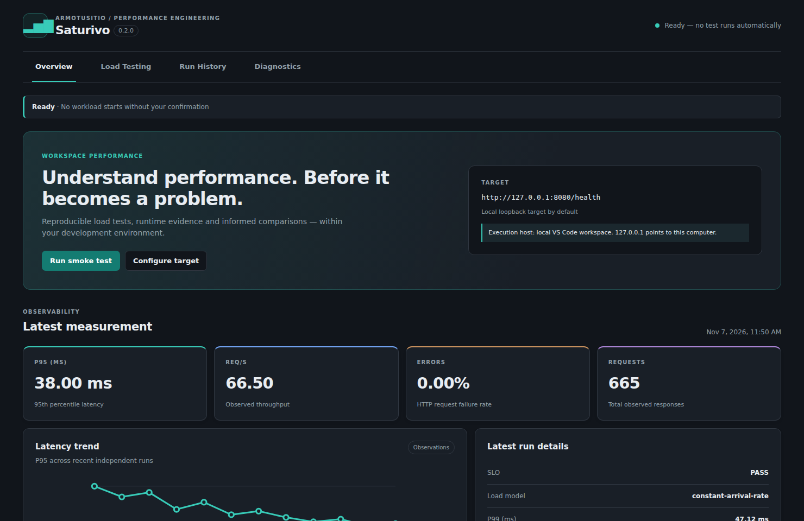
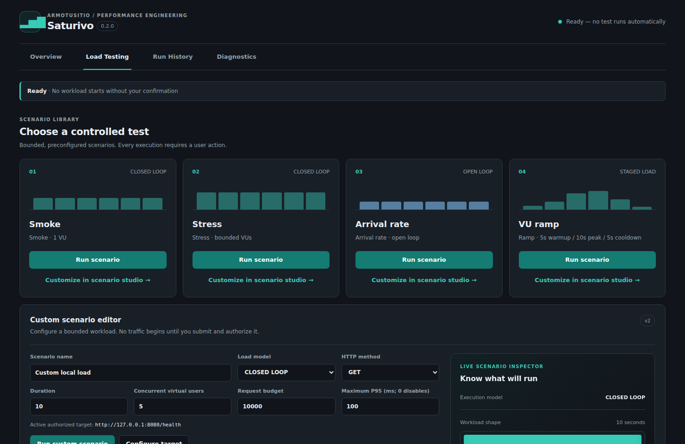
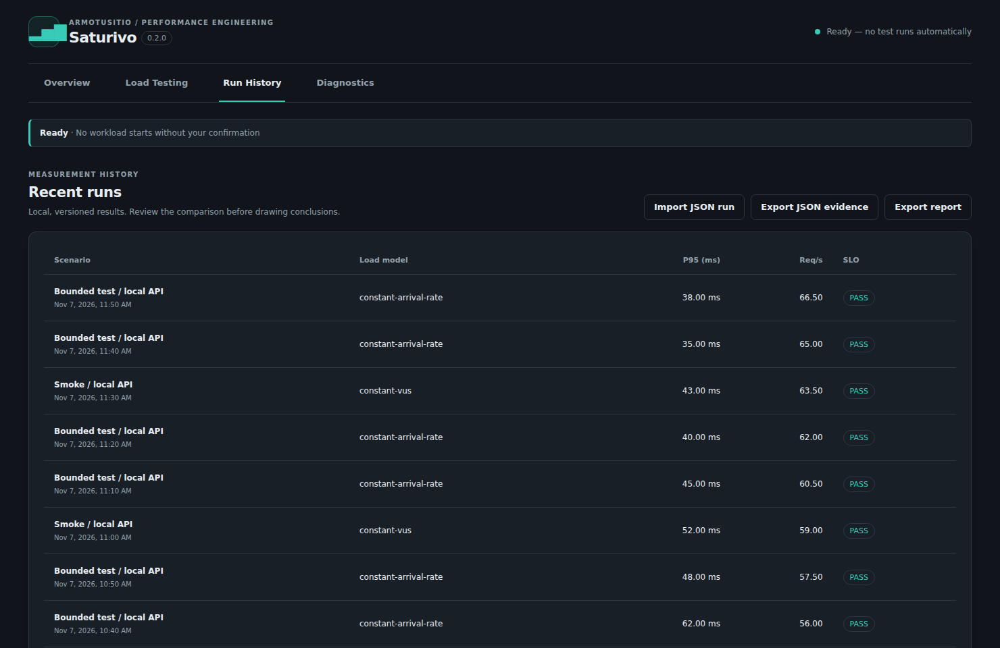
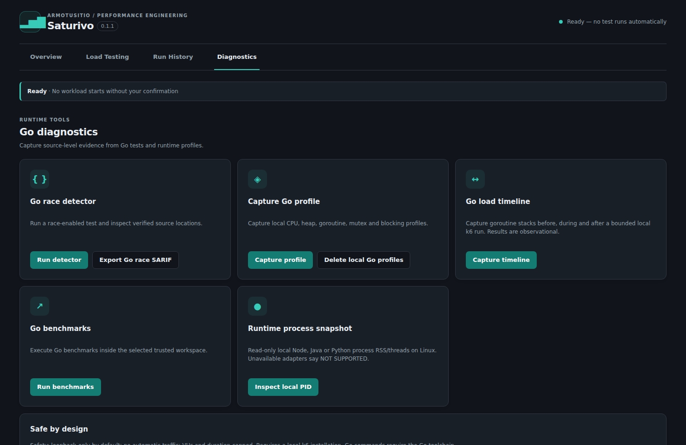

# Saturivo — Guía en español

  

<strong>Encontrá los límites. Identificá los cuellos de botella.</strong>

Diagnóstico de carga, concurrencia y rendimiento basado en evidencia, integrado en Visual Studio Code.

[English README](../README.md) · [Arquitectura](../ARCHITECTURE.md) · [Estado real](../STATUS.md) · [Plan Enterprise AAAA](ENTERPRISE_AAAA_MASTER_PLAN.md)

> **Versión estable publicada: 0.3.1.** La rama de upgrade propone **0.4.0 (NO PUBLICADA)**. Conserva el logo, la identidad visual y la disposición del Centro de Control. La verificación de instalación y las mejoras de evidencia requieren pasar CI, merge y publicación antes de distribuirse.

## Verificar instalación sin ejecutar pruebas (candidato 0.4.0)

Desde el Centro de Control, elegí **Verificar instalación** o ejecutá el comando **Saturivo: Verificar instalación local (sin carga)**. Se comprueban la disponibilidad y versión de k6, la presencia opcional de Go y la política del endpoint. Se abre un reporte en español; no se inicia tráfico ni se comprueba que el servidor esté vivo. Si falta k6, instalalo según la guía oficial y reiniciá VS Code cuando cambies PATH. Luego ejecutá Smoke manualmente sobre un servicio autorizado y descartable.

Las métricas de HTTP incompletas dejan de aceptarse como evidencia válida; el historial conserva las ejecuciones sanas aunque existan archivos corruptos. Los informes y logs de WebSocket ocultan parámetros de consulta. No se altera el logo ni el diseño.

## Centro de Control — 0.3.0

Saturivo ahora abre el Centro de Control en una **pestaña del editor**, con espacio para métricas, escenarios, historial y diagnóstico. Las capturas provienen del **renderizador real de la interfaz** con datos sintéticos y deterministas: **no representan mediciones reales**.

Ver escenarios, historial y diagnóstico Go

### Una experiencia diseñada para desarrolladores

El Centro de Control propone un recorrido claro: **configurar → medir → analizar**. El **Scenario Studio** incluye una previsualización dinámica de las etapas, presupuestos de carga visibles, validación antes de ejecutar y presets que se pueden personalizar **sin enviar tráfico**. Los resultados agregan tablas accesibles, comparaciones contextualizadas y estados vacíos con acciones útiles.

La interfaz respeta los temas de VS Code, el teclado, los diseños adaptables y la preferencia de movimiento reducido. Seleccionar o editar un escenario nunca inicia una prueba automáticamente.

## ¿Para qué sirve?

Saturivo permite medir cómo responde una API bajo una carga controlada, guardar las condiciones de la prueba, comparar ejecuciones compatibles y observar señales de concurrencia en aplicaciones Go. Usa herramientas consolidadas, como **Grafana k6**, **go test -race** y **go tool pprof**, en lugar de inventar otro motor de carga.

| Necesidad | Función |
|---|---|
| Medir una API local | Presets de carga y editor de escenarios HTTP v2 (GET/HEAD) con límites y consentimiento |
| Entender la degradación | P50/P95/P99, solicitudes por segundo, fallos e iteraciones descartadas |
| Comparar cambios | Huella SHA-256, selección de baseline e incertidumbre con pruebas repetidas |
| Comprobar WebSocket | Prueba k6 de handshake y mensajes limitada a ws:// loopback, 5 segundos, 1 VU y hasta 100 sesiones; métricas de sesión, no latencia HTTP |
| Analizar Go | Race detector, benchmarks, perfiles CPU, heap, goroutines, mutex/block, traza local y snapshots antes/durante/después |
| Guardar evidencia | Exportación Markdown, JSON y SARIF para carreras observadas |

**Piloto experimental de capacidad:** tres etapas de carga explícita local con SLO P95; no certifica capacidad de producción. Saturivo 0.2.0 ya implementa ventanas warm-up/medición/cool-down aisladas, comparaciones 3×3 con incertidumbre, navegación de hallazgos Go race a fuente verificada, pprof/trace/GC, HTTP real Go/Node/Python y WebSocket RFC6455. **No implementado o no validado:** gRPC/ghz, profilers especializados Node/Java/Python, WSL/SSH/Dev Containers E2E e IA BYO. Upgrade VSIX 0.1.0→0.2.0 con persistencia de historial PASS Windows/macOS/Linux en [CI #42422983667](https://github.com/Drako01/saturivo/actions/runs/42422983667). Las cuatro imágenes README fueron actualizadas con datos sintéticos, commit `6387739`; el CI postcapturas [CI #42424211042](https://github.com/Drako01/saturivo/actions/runs/42424211042) pasó 7/7 en `e777dda`; faltan revisión visual humana y el CI del SHA final tras esta actualización.

## Instalación y uso

**Requisitos:** VS Code 1.99+, Grafana k6 en `PATH`; Go instalado para análisis de concurrencia. Node.js 22+ y npm para compilar desde el repositorio público.

~~~bash
git clone https://github.com/Drako01/saturivo.git
cd saturivo
git switch feat/enterprise-aaaa-v0.1.1
npm ci --ignore-scripts
npm run verify
npm run package:vsix
~~~

En VS Code ejecutá **Extensions: Install from VSIX…** y seleccioná `saturivo.vsix`.

1. Iniciá una API descartable en `127.0.0.1`, usando datos sintéticos y dependencias aisladas.
2. Abrí el **Centro de Control** desde el ícono Saturivo. Esto **no genera tráfico automáticamente**.
3. Elegí **Configurar destino** y completá la URL local.
4. Ejecutá una prueba rápida, una carga por usuarios virtuales o una tasa de llegadas (*open loop*). Podés cancelar.
5. Revisá P95/P99, RPS, errores e historial; repetí el mismo escenario, elegí un baseline explícito y exportá resultados.

**Editor propio:** en Pruebas de carga podés definir GET/HEAD, VUs, tasa de llegadas o etapas de rampa, duración, presupuesto y P95 objetivo. El calentamiento y enfriamiento opcionales se separan de la ventana medida: P50/P95/P99, errores y RPS se calculan únicamente para esa ventana, mientras el presupuesto sigue cubriendo toda la ejecución. La extensión revalida todo antes de ejecutar. **WebSocket:** existe una prueba separada de loopback que pide endpoint ws:// y consentimiento; sus métricas corresponden a sesiones WebSocket, no a requests HTTP.

**Piloto de capacidad local:** configurá primero un SLO P95, elegí una URL HTTP con IP literal de loopback (por ejemplo `http://127.0.0.1:8080/health`) y ejecutá **Piloto de capacidad local**. Hace hasta 3 etapas acotadas de 10 segundos (10, 20 y 40 llegadas/s), con presupuesto finito, cancelación y corte por SLO o evidencia insuficiente. No representa el límite real de producción.

## Configuración recomendada

~~~json
{
  "saturivo.target": "http://127.0.0.1:8080/health",
  "saturivo.k6Path": "k6",
  "saturivo.durationSeconds": 10,
  "saturivo.maxVirtualUsers": 100,
  "saturivo.maxRequests": 10000,
  "saturivo.sloMaxP95Ms": 250,
  "saturivo.allowRemoteTargets": false,
  "saturivo.goProfilerOrigin": "http://127.0.0.1:6060/"
}
~~~

La duración admite 5–120 segundos; el límite global, 1–100 usuarios virtuales; y el presupuesto, 100–100000 solicitudes. Los presets incorporados usan cargas menores. El objetivo P95 es opcional; `0` lo desactiva.

**Interpretación importante:** P95/P99 son percentiles de latencia; RPS representa throughput logrado; las iteraciones descartadas indican que el generador no pudo sostener la tasa solicitada. Un estado **INCONCLUSO** evita afirmar éxito cuando falta evidencia o se alcanzó el presupuesto de solicitudes.

Cuando existen al menos tres ejecuciones compatibles por grupo, Saturivo permite una comparación estadística inicial de la mediana P95 con bootstrap. Una sola ejecución no prueba una mejora ni una regresión causal.

## Concurrencia en Go

**Detector de carreras:** con confirmación explícita ejecuta `go test -race ./...`. Los accesos concurrentes observados se asocian a archivos y líneas del panel **Problems** y pueden exportarse como SARIF. Que no aparezcan hallazgos no significa que el programa esté libre de carreras.

**Benchmarks:** ejecuta `go test -run ^$ -bench . -benchmem ./...` después de confirmar. Los tests pueden ejecutar código del proyecto; usá entornos controlados.

**Profiling:** habilitá `net/http/pprof` solamente en un listener HTTP local de desarrollo (por ejemplo, `127.0.0.1:6060`), configurá el origen en Saturivo y capturá CPU, heap, goroutines, mutex, block o una traza Go de duración acotada. Los artefactos quedan locales. El estado de las goroutines es una fotografía del momento, no una prueba definitiva de fugas.

## Seguridad y privacidad

- Sin carga ni profiling automáticos; cada ejecución requiere una acción del usuario.
- Solo loopback de forma predeterminada. Un destino remoto necesita configuración explícita y confirmación por ejecución.
- Tráfico HTTP de lectura (GET/HEAD), sin redirecciones y con límites de duración, concurrencia y solicitudes.
- Comandos externos sin expansión por shell, con timeout, cancelación y salida acotada.
- Profiling Go restringido a una IP literal de loopback, con límite de tamaño y duración.
- Workspace Trust obligatorio; Webview protegida con CSP.
- Sin telemetría propia, subidas automáticas ni envío de código a modelos de IA.
- El historial local admite eliminación explícita. Perfiles y reportes pueden contener información sensible: revisalos antes de compartirlos.

**No ejecutes pruebas de estrés contra producción o servicios de terceros sin autorización expresa.** Incluso una prueba local puede afectar una base de datos o un servicio downstream.

## Calidad y estado

El commit anterior `cbd3724` del PR #5 pasó las siete verificaciones del [CI #42404881890](https://github.com/Drako01/saturivo/actions/runs/42404881890): checks en Linux/Windows/macOS, integración real con k6, instalación VSIX en Extension Host, fixture Go race/pprof y artefactos de SBOM. Esto acredita solo ese commit, **no** los cambios posteriores ni el cumplimiento completo de Enterprise AAAA.

Para conocer los pendientes reales, revisá el [checklist](ENTERPRISE_AAAA_UPGRADE_CHECKLIST.md), los [criterios de aceptación](ACCEPTANCE_CRITERIA.md) y el [plan maestro](ENTERPRISE_AAAA_MASTER_PLAN.md).

---

**Saturivo** es desarrollado por **Alejandro Daniel Di Stefano — [ArmoTuSitio](https://armotusitio.com.ar)**. Licencia MIT. Repositorio público bajo licencia MIT; extensión todavía sin publicar.

## Comunidad y contribuciones

El repositorio de Saturivo es **público**. Aceptamos issues reproducibles, pruebas, documentación, accesibilidad y PRs siguiendo [CONTRIBUTING.md](../CONTRIBUTING.md) y el [Código de conducta](../CODE_OF_CONDUCT.md). Las vulnerabilidades se reportan en privado por [SECURITY.md](../SECURITY.md).

Las protecciones **ya están activas** en GitHub: [Protect main](https://github.com/Drako01/saturivo/rules/26766004) y [Protect release tags](https://github.com/Drako01/saturivo/rules/26766025). Se verificaron contra las configuraciones de Orquestivo. Consultá [RULESETS.md](RULESETS.md), el [modelo de gobernanza](GOVERNANCE.md) y [SUPPORT.md](../SUPPORT.md).
